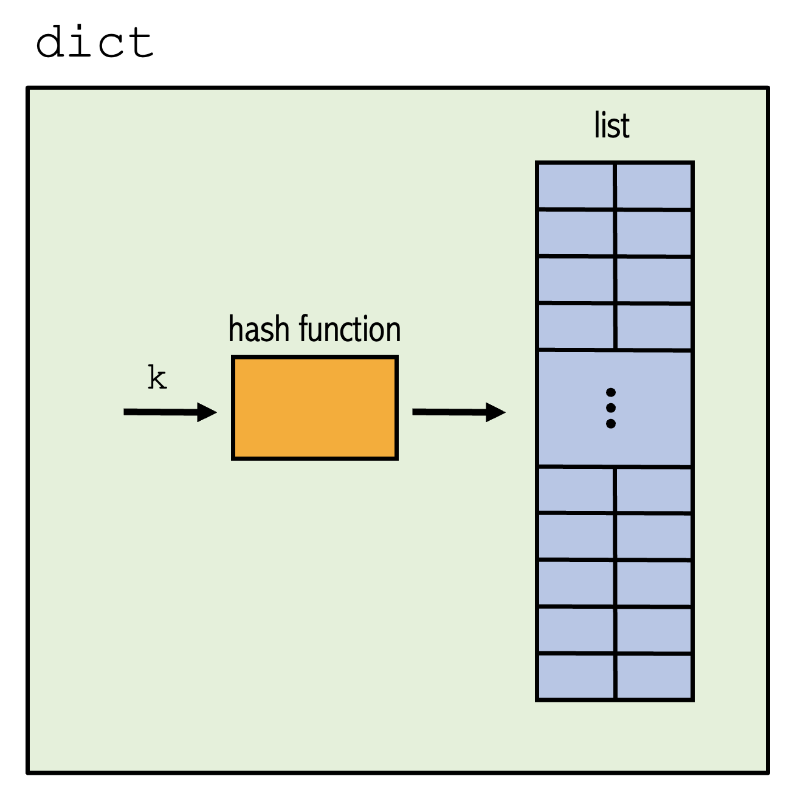

## Announcements

<style>
.small { font-size: .9rem; }
.tiny { font-size: .8rem; }
.card { border: 2px solid #ddd; border-radius: 12px; padding: 14px 16px; margin: 10px 0; }
.center { text-align:center; }
.rule { font-family: ui-monospace, SFMono-Regular, Menlo, Consolas, monospace; }
</style>


# Feature Spaces and the Curse of Dimensionality

## Today

- Think of data as points in a **feature space** $X$
- Count how big $X$ gets as we:
  - add more features
  - increase feature precision
- See why data are **sparse** in high dimensions
- Connect this to **learning a function** $f : X \to Y$ from data


## Quick recap: functions and models

From last time:

- A **model / classifier** is a function $f : X \to Y$
  - $X$ = input space / feature space
  - $Y$ = labels or outputs
- For finite $X$ and $Y$:
  - If $|X| = N$ and $|Y| = m$ then there are $m^N$ functions $X \to Y$
- Example:
  - $X = \{0,1\}^3$ (3-bit vectors), so $|X| = 8$
  - Binary labels $Y = \{0,1\}$: there are $2^8 = 256$ classifiers


## Quick recap: learning from data

- There is some unknown **true function** $f : X \to Y$
- We see **data**:
  $$
  D = \{(x_1, y_1), \dots, (x_n, y_n)\}, \quad y_i = f(x_i)
  $$
- We pick a function $h$ (our model) that:
  - agrees with the data (or mostly agrees)
  - we hope generalizes to new $x \in X$

Today’s question:

> What is this space $X$ really like, and why does it cause trouble?


## How many images exist? {.activity}

Consider black-and-white images:

- Size: $28 \times 28$ pixels
- Each pixel is either 0 (black) or 1 (white)

**Question:**  
If each pixel can be 0 or 1, how many different images are possible?

- Think: how many pixels? how many choices per pixel?
- Discuss with a neighbor and write your answer as a power of 2.


## Counting images

- There are $28 \times 28 = 784$ pixels
- Each pixel: 2 choices (0 or 1)

So the number of possible images is:

$$
2^{784}.
$$

We can estimate:

- $\log_{10}(2^{784}) = 784 \log_{10} 2 \approx 784 \cdot 0.301 \approx 236$
- So about $10^{236}$ possible images


## Images as feature vectors

We can think of each image as a point in a **feature space**:

- Feature space:
  $$
  X = \{0,1\}^{784}
  $$
- Each image is a 784-dimensional vector of 0s and 1s
- Size of $X$: $|X| = 2^{784}$

A digit recognizer is a function:

$$
f : X \to \{0,1,\dots,9\}
$$

that assigns a label to each possible image.


## Data and the Domain {.smaller}

In practice:

- We might have tens of thousands or millions of labeled images
- But the total number of possible images is on the order of $10^{236}$

So:

> Our training set is a **microscopic fraction** of the full input space $X$.

Yet we want $f$ to behave well on images it has never seen.

This is one face of the **curse of dimensionality**.


## Binary feature vectors

Now simplify:

- Suppose examples are described by $d$ **binary features**
  - Each feature: 0 or 1
- The feature space is:
  $$
  X = \{0,1\}^d
  $$

How big is $X$?

- There are $2$ choices for each of the $d$ features
- So:
  $$
  |X| = 2^d
  $$


## 10 features vs 20 vs 30 {.activity}

Suppose we have a dataset with $n = 10{,}000$ examples  
(assume they are all distinct points in $X$).

Fill in this table:

| # features $d$ | $|X| = 2^d$ (approx) | Could 10,000 data points cover all of $X$? | Rough fraction seen $n/|X|$ |
|---------------:|----------------------|--------------------------------------------|-----------------------------|
| 10             |                      |                                            |                             |
| 20             |                      |                                            |                             |
| 30             |                      |                                            |                             |


## 10 features vs 20 vs 30

Let’s plug in:

- $d = 10$: $|X| = 2^{10} = 1{,}024$
- $d = 20$: $|X| = 2^{20} \approx 1{,}000{,}000$
- $d = 30$: $|X| = 2^{30} \approx 1{,}000{,}000{,}000$

With $n = 10{,}000$ data points:

| # features $d$ | $|X|$          | Can 10,000 cover all of $X$?                | Fraction $n/|X|$          |
|---------------:|---------------:|---------------------------------------------|---------------------------|
| 10             | $1{,}024$      | Yes (even many repeats)                     | $\approx 10$              |
| 20             | $\approx 10^6$ | No                                          | $\approx 10^{-2}$         |
| 30             | $\approx 10^9$ | Definitely not                              | $\approx 10^{-5}$         |

As we add features, $|X|$ explodes, and the **fraction** of $X$ we see shrinks rapidly.


## Functions on a huge $X$

Recall:

- For a finite input space $X$ with $|X| = N$ and binary labels:
  $$
  \#\{f : X \to \{0,1\}\} = 2^N
  $$

If we have labeled data on $n$ distinct inputs:

- The function is fixed on those $n$ points
- Free on the remaining $N - n$ points
- So the number of functions consistent with the data is:
  $$
  2^{N - n}
  $$

If $N$ is huge and $n \ll N$, then $N - n \approx N$:
there are still **astronomically many** functions that fit the data perfectly.


## Example: 20 binary features

Take $d = 20$ binary features:

- Feature space size:
  $$
  |X| = 2^{20} \approx 1{,}000{,}000
  $$
- Suppose we have $n = 10{,}000$ labeled examples

Then:

- $N = 2^{20}$, $N - n \approx 990{,}000$
- Number of functions $X \to \{0,1\}$ **consistent** with the data:
  $$
  2^{N - n} \approx 2^{990{,}000}
  $$

Even after seeing 10,000 examples, there are still wildly many
possible functions that agree with all observed labels.


## From discrete to continuous features

Now imagine each feature is a **real number** in $[0,1]$:

- Feature space:
  $$
  X = [0,1]^d
  $$
- A model is a function:
  $$
  f : [0,1]^d \to Y
  $$

We’d like our data to be dense enough that we can approximate $f(x)$  
**everywhere** in $[0,1]^d$, not just at the sample points.


## A grid in 1 dimension

Start with $d=1$:

- Interval $[0,1]$
- We want a resolution of about $0.1$:
  - Divide into 10 equal segments
  - Place a grid point in each segment

We need about **10** points to cover $[0,1]$ at resolution $0.1$.

(Each point “represents” nearby values.)


## A grid in 2 and 3 dimensions {.activity}

Now $d=2$:

- Square $[0,1]^2$
- Use the same spacing $0.1$ in each dimension:
  - 10 grid points along $x$
  - 10 grid points along $y$
  - Total grid points: $10 \times 10 = 100$

$d=3$:

- Cube $[0,1]^3$
- 10 grid points per dimension → $10^3 = 1{,}000$ total

**Question:**  
With a partner, extend this pattern to $d = 5$ and $d = 10$:


## A grid in $d$ dimensions

In general:

- If we use 10 grid points per dimension (spacing $\approx 0.1$),
- Then the total number of grid points is:
  $$
  10^d
  $$

Some values:

- $d = 2$: $10^2 = 100$
- $d = 5$: $10^5 = 100{,}000$
- $d = 10$: $10^{10} = 10{,}000{,}000{,}000$

To “cover” $[0,1]^d$ with this resolution, we’d need about $10^d$ samples.


## What can 10,000 points cover?

Suppose we have $n = 10{,}000$ data points.

Compare:

- $d=2$: need $\approx 100$ grid points
  - 10,000 >> 100 → many points per cell
- $d=5$: need $\approx 100{,}000$ grid points
  - 10,000 < 100,000 → many empty cells
- $d=10$: need $\approx 10^{10}$ grid points
  - 10,000 is negligible

As dimension $d$ grows, a fixed number of points becomes **very sparse** in $[0,1]^d$.


## Curse of dimensionality

One way to state it:

> To approximate an arbitrary function $f : [0,1]^d \to Y$ everywhere with a fixed resolution, the number of required samples grows **exponentially** with the dimension $d$.

So:

- High-dimensional spaces are extremely sparse
- Most of the volume is “far away” from any given data point
- It is impossible to densely sample the space unless we have an enormous amount of data


## Putting it together: data, functions, and generalization {.smaller}

Across these two lessons:

- The input space $X$ (feature space) can be **huge**:
  - discrete: $|X| = 2^d$ for $d$ binary features
  - continuous: $[0,1]^d$ needs $10^d$ grid points for modest resolution
- A model is a function $f : X \to Y$
- Even after observing data on $n$ points:
  - there are still many functions that fit the data perfectly
  - especially when $|X|$ is enormous and $n \ll |X|$

ML algorithms cope by:

- restricting to a **structured hypothesis class** (linear, trees, neural nets, …)
- using inductive biases (smoothness, simplicity, etc.) so that sparse data can still guide the choice of $f$


## Big picture {.smaller}

- Counting tells us that:
  - High-dimensional feature spaces explode in size
  - Our datasets occupy a tiny fraction of those spaces
- Functions lesson:
  - Huge number of possible functions $f : X \to Y$
  - Many functions remain consistent with the same data
- Curse-of-dimensionality lesson:
  - As dimension grows, data become sparser
  - Approximating a function everywhere in $X$ requires exponentially many samples

**Reflection:**

> In your own words: why does adding more features make learning a function from data harder, from a *counting* perspective?

# Hashing

## Lists vs dictionaries

Suppose we want to store our friends’ favourite drink orders...

Use a **list** of pairs:

``` {pyodide}
orders_list = [
    ("Alex",   "iced oat latte"),
    ("Bianca", "mango bubble tea"),
    ("Dev",    "cold brew, black"),
    ("Sam",    "matcha latte")
]

print(orders_list[3])
```

How do we find Bianca's order?

## Finding things with a list {.smaller}

If we store data in a list, to find Bianca’s order we have to **search**:

``` {pyodide}
def order_from_list(query_name, orders):
    for (n, drink) in orders:
        if n == query_name:
            return drink
    return None   # not found

print(order_from_list("Bianca", orders_list))
```

* Do you like this? 
* What if the list were very long?
* What's so special about the indices?

## Python moment {.smaller}

Python has an implementation of an *Associative Array* called a `dict`.

``` {pyodide}
orders_dict= dict(orders_list)
print(orders_list)
print(orders_dict)
```

``` {pyodide}
print(orders_dict["Bianca"])
```

## Example Key: Value pairs {.smaller}

We often want to map one kind of thing (the **key**) to another kind of thing (the **value**):

::::: columns 
::: {.column}

- **Song title → artist**
  - `"Anti-Hero" → "Taylor Swift"`
- **Course code → course title**
  - `"DSCI100" → "Intro to DSci"`

- **Email address → user ID**
  - `"alex@ubc.ca" → 1043921`
- **Date → temperature**
  - `"2025-11-27" → 9.3`
:::
::: {.column}

- **Flight → destination**
  - `"AC598" → SNA`
- **City name → population**
  - `"Vancouver" → 662248`
- **Word → number of times it appears**
  - `"hashing" → 17`
- **user ID → Email address**
  - `1043921 → "alex@ubc.ca"`

:::
:::::

All of these are naturally modeled as **key–value pairs** — exactly what Python dictionaries (and hash tables) are built for.

## Hashing {.smaller}


::::: columns 
::: {.column}

\ 

\ 

``` {pyodide}
d = dict()
d['AC598'] = 'SNA'
```
:::
::: {.column}

:::
::::: 

## Where we are {.smaller}

- We’ve been thinking about **functions**:
  - $f : X \to Y$
  - “every $x \in X$ gets exactly one $y \in Y$”
- We saw:
  - functions as sets of input–output pairs,
  - counting functions,
  - huge feature spaces ($X$ can be enormous).

Today:

- A *special* and practical kind of function:
  - a **hash function**.
- Goal:
  - connect hashing to our **function** language,
  - introduce **injective / surjective** via a concrete example


## Arrays vs *associative arrays* {.smaller}

A simple array/list:

- Indices: $0,1,2,\dots,m-1$
- Values: whatever we store there
- Access: by integer position, `A[3]` 

An **associative array**:

- Keys: strings, IDs, course codes,
- Access: by key, `T["DSCI220"]`  

Idea:

> Use a **function** that turns a key into an **index**.

That function is called a **hash function**.

## Recall: functions {.smaller}

Formal definition:

> A function $f : X \to Y$ assigns to each input $x \in X$ **exactly one** output $y \in Y$.

- $X$ = **domain**
- $Y$ = **codomain**

Today’s special case:

- $X$ = set of **keys** (e.g., strings like `"DSCI220"`)
- $Y$ = set of **indices** $\{0,1,\dots,m-1\}$

So a **hash function** is just:

$$
h : \text{Keys} \to \{0,1,\dots,m-1\}.
$$


## Example {.activity}

Let’s start with a set of keys:

- `"MATH101"`, `"DSCI220"`, `"STAT201"`, `"DSCI221"`

And an array:

<svg width="420" height="120" viewBox="0 0 420 120" xmlns="http://www.w3.org/2000/svg">
<rect x="20" y="20" width="380" height="50"
        fill="none" stroke="white" stroke-width="2" />
<line x1="115" y1="20" x2="115" y2="70" stroke="white" stroke-width="2" />
  <line x1="210" y1="20" x2="210" y2="70" stroke="white" stroke-width="2" />
  <line x1="305" y1="20" x2="305" y2="70" stroke="white" stroke-width="2" />
<text x="67"  y="100" text-anchor="middle" font-family="monospace" font-size="16" fill="white">0</text>
  <text x="162" y="100" text-anchor="middle" font-family="monospace" font-size="16" fill="white">1</text>
  <text x="257" y="100" text-anchor="middle" font-family="monospace" font-size="16" fill="white">2</text>
  <text x="352" y="100" text-anchor="middle" font-family="monospace" font-size="16" fill="white">3</text>
</svg>

Goal: Define a hash function $h$


## Observations {.smaller}


<svg width="520" height="240" viewBox="0 0 520 240" xmlns="http://www.w3.org/2000/svg">
<text x="60" y="60"  font-family="monospace" font-size="16">MATH101</text>
  <text x="60" y="100" font-family="monospace" font-size="16">STAT201</text>
  <text x="60" y="140" font-family="monospace" font-size="16">DSCI220</text>
  <text x="60" y="180" font-family="monospace" font-size="16">DSCI221</text>
<rect x="260" y="40" width="160" height="160"
        fill="none" stroke="black" stroke-width="2" />
<line x1="260" y1="80" x2="420" y2="80" stroke="black" stroke-width="2" />
  <line x1="260" y1="120" x2="420" y2="120" stroke="black" stroke-width="2" />
  <line x1="260" y1="160" x2="420" y2="160" stroke="black" stroke-width="2" />
<text x="240" y="68"  text-anchor="end" font-family="monospace" font-size="16">0</text>
  <text x="240" y="108" text-anchor="end" font-family="monospace" font-size="16">1</text>
  <text x="240" y="148" text-anchor="end" font-family="monospace" font-size="16">2</text>
  <text x="240" y="188" text-anchor="end" font-family="monospace" font-size="16">3</text>
</svg>

Notes:

- Every key has **exactly one** hash value. Why must this be true?
- No 2 keys share the same output.
- Every index is the output from *some* input.
- We call this a **perfect hash function**

## Vocabulary: injective / surjective {.smaller}

Let $f : X \to Y$.

- $f$ is **Injective (one-to-one)** if:
  - $x_1 \ne x_2$ implies $f(x_1) \ne f(x_2)$.
  - No two different inputs share the same output.

- $f$ is **Surjective (onto)** if:
  - For every $y \in Y$, there is at least one $x \in X$ with $f(x) = y$.
  - Every output value is used.

- $f$ is **Bijective** if:
  - it is both injective and surjective.
  - Perfect “pairing” between $X$ and $Y$.

On our 4 course codes and 4 buckets, $h$ is **bijective**, a **perfect hash** for that key set.

## Perfect hash functions {.smaller}

If we fix a finite set of keys $K$:

- A function $h : K \to \{0,\dots,m-1\}$ is a **perfect hash** for $K$ if:
  - $h$ is **injective** on $K$ (no two keys collide),
  - so each key gets its own bucket.

If also $|K| = m$ and $h$ is surjective, then $h$ is **bijective** on $K$.

> Perfect hash ⇒ no collisions (for that *particular* key set).

BUT:

- It might be very **hand-crafted** and fragile.
- It might stop being perfect as soon as we add more keys.


## What if we add more keys? {.activity}

- Keys: `"MATH101"`, `"DSCI220"`, `"STAT201"`, `"DSCI221"`, `"DSCI100"`, `"CPSC330"`, `"STAT200"`
- Buckets: $\{0,1,2,3\}$ (4 buckets)
- Hash: $h(\text{"*}xyz\text{"}) = (x+y+z) \bmod 4$

Question:

1. We now have 7 keys and still 4 bucket. Can **any** function from these 7 keys to $\{0,1,2,3\}$ be injective?
2. Why or why not?


## Pigeonhole principle (PHP) {.smaller}

Formal version in our language:

- If $|X| > |Y|$, then **no** function $f : X \to Y$ can be injective.

Apply to hashing:

- Keys = pigeons
- Buckets = pigeonholes

If we have more keys than buckets:

- $$|\text{Keys}| > m = |\{0,\dots,m-1\}|,$$
- **no** hash function $h : \text{Keys} \to \{0,\dots,m-1\}$ can be one-to-one on that key set.


## Collisions {.smaller}

A **collision** happens when two different keys share the same hash value:

$$
k_1 \ne k_2, \quad h(k_1) = h(k_2).
$$

By the pigeonhole principle:

- As soon as we have **more keys than buckets**,  
  collisions are **guaranteed** (for *every* hash function).


## A Rosey Hash Function

<svg width="640" height="480" viewBox="0 0 640 480" xmlns="http://www.w3.org/2000/svg">
<ellipse cx="170" cy="220" rx="120" ry="130"
           fill="#e6ccff" stroke="black" stroke-width="2" />
<rect x="120" y="140" width="40" height="40"
        rx="6" ry="6"
        fill="white" stroke="black" stroke-width="2" />
  <rect x="180" y="140" width="40" height="40"
        rx="6" ry="6"
        fill="white" stroke="black" stroke-width="2" />
<rect x="150" y="200" width="40" height="40"
        rx="6" ry="6"
        fill="white" stroke="black" stroke-width="2" />
<rect x="120" y="260" width="40" height="40"
        rx="6" ry="6"
        fill="white" stroke="black" stroke-width="2" />
  <rect x="180" y="260" width="40" height="40"
        rx="6" ry="6"
        fill="white" stroke="black" stroke-width="2" />
<rect x="380" y="30" width="120" height="420"
        fill="#ffe6f0" stroke="black" stroke-width="2" />
<line x1="380" y1="50"  x2="500" y2="50"  stroke="black" stroke-width="1" />
  <line x1="380" y1="70"  x2="500" y2="70"  stroke="black" stroke-width="1" />
  <line x1="380" y1="90"  x2="500" y2="90"  stroke="black" stroke-width="1" />
  <line x1="380" y1="110" x2="500" y2="110" stroke="black" stroke-width="1" />
  <line x1="380" y1="130" x2="500" y2="130" stroke="black" stroke-width="1" />
  <line x1="380" y1="150" x2="500" y2="150" stroke="black" stroke-width="1" />
  <line x1="380" y1="170" x2="500" y2="170" stroke="black" stroke-width="1" />
  <line x1="380" y1="190" x2="500" y2="190" stroke="black" stroke-width="1" />
  <line x1="380" y1="210" x2="500" y2="210" stroke="black" stroke-width="1" />
  <line x1="380" y1="230" x2="500" y2="230" stroke="black" stroke-width="1" />
  <line x1="380" y1="250" x2="500" y2="250" stroke="black" stroke-width="1" />
  <line x1="380" y1="270" x2="500" y2="270" stroke="black" stroke-width="1" />
  <line x1="380" y1="290" x2="500" y2="290" stroke="black" stroke-width="1" />
  <line x1="380" y1="310" x2="500" y2="310" stroke="black" stroke-width="1" />
  <line x1="380" y1="330" x2="500" y2="330" stroke="black" stroke-width="1" />
  <line x1="380" y1="350" x2="500" y2="350" stroke="black" stroke-width="1" />
  <line x1="380" y1="370" x2="500" y2="370" stroke="black" stroke-width="1" />
  <line x1="380" y1="390" x2="500" y2="390" stroke="black" stroke-width="1" />
  <line x1="380" y1="410" x2="500" y2="410" stroke="black" stroke-width="1" />
  <line x1="380" y1="430" x2="500" y2="430" stroke="black" stroke-width="1" />
<text x="390" y="44"  font-family="monospace" font-size="14">20</text>
  <text x="390" y="64"  font-family="monospace" font-size="14">19</text>
  <text x="390" y="84"  font-family="monospace" font-size="14">18</text>
  <text x="390" y="104" font-family="monospace" font-size="14">17</text>
  <text x="390" y="124" font-family="monospace" font-size="14">16</text>
  <text x="390" y="144" font-family="monospace" font-size="14">15</text>
  <text x="390" y="164" font-family="monospace" font-size="14">14</text>
  <text x="390" y="184" font-family="monospace" font-size="14">13</text>
  <text x="390" y="204" font-family="monospace" font-size="14">12</text>
  <text x="390" y="224" font-family="monospace" font-size="14">11</text>
  <text x="390" y="244" font-family="monospace" font-size="14">10</text>
  <text x="394" y="264" font-family="monospace" font-size="14">9</text>
  <text x="394" y="284" font-family="monospace" font-size="14">8</text>
  <text x="394" y="304" font-family="monospace" font-size="14">7</text>
  <text x="394" y="324" font-family="monospace" font-size="14">6</text>
  <text x="394" y="344" font-family="monospace" font-size="14">5</text>
  <text x="394" y="364" font-family="monospace" font-size="14">4</text>
  <text x="394" y="384" font-family="monospace" font-size="14">3</text>
  <text x="394" y="404" font-family="monospace" font-size="14">2</text>
  <text x="394" y="424" font-family="monospace" font-size="14">1</text>
  <text x="394" y="444" font-family="monospace" font-size="14">0</text>
</svg>

## From “perfect” to “general-purpose” {.smaller}

We’ve seen: On a tiny, fixed set of keys, we can sometimes build a **perfect hash**

But for **general-purpose hashing**:

- The key space is HUGE (all possible strings, IDs, ...), so we only ever see a **sample** of keys in our data.
- For any *fixed* hash function \(h : \text{Keys} \to \{0,\dots,m-1\}\)... 

<svg width="720" height="260" viewBox="0 0 720 260" xmlns="http://www.w3.org/2000/svg">
<defs>
    <marker id="arrowhead" markerWidth="10" markerHeight="7"
            refX="9" refY="3.5" orient="auto">
      <polygon points="0 0, 10 3.5, 0 7" fill="black" />
    </marker>
  </defs>
<circle cx="160" cy="130" r="100"
          fill="#e6ccff" stroke="black" stroke-width="2" />
<circle cx="190" cy="115" r="45"
          fill="#ccffff" stroke="black" stroke-width="1.5" />
<circle cx="190" cy="110" r="4" fill="black" />
  <circle cx="175" cy="125" r="4" fill="black" />
  <circle cx="205" cy="130" r="4" fill="black" />
<circle cx="115" cy="80"  r="4" fill="black" />
  <circle cx="130" cy="150" r="4" fill="black" />
  <circle cx="100" cy="130" r="4" fill="black" />
  <circle cx="145" cy="190" r="4" fill="black" />
  <circle cx="210" cy="175" r="4" fill="black" />
  <circle cx="220" cy="70"  r="4" fill="black" />
  <circle cx="90"  cy="105" r="4" fill="black" />
<line x1="260" y1="130" x2="390" y2="130"
        stroke="black" stroke-width="2" marker-end="url(#arrowhead)" />
<rect x="410" y="80" width="280" height="80"
        fill="#ffe6f0" stroke="black" stroke-width="2" />
<line x1="445" y1="80" x2="445" y2="160" stroke="black" stroke-width="1" />
  <line x1="480" y1="80" x2="480" y2="160" stroke="black" stroke-width="1" />
  <line x1="515" y1="80" x2="515" y2="160" stroke="black" stroke-width="1" />
  <line x1="550" y1="80" x2="550" y2="160" stroke="black" stroke-width="1" />
  <line x1="585" y1="80" x2="585" y2="160" stroke="black" stroke-width="1" />
  <line x1="620" y1="80" x2="620" y2="160" stroke="black" stroke-width="1" />
  <line x1="655" y1="80" x2="655" y2="160" stroke="black" stroke-width="1" />
<text x="427" y="185" text-anchor="middle" font-family="monospace" font-size="12">0</text>
  <text x="462" y="185" text-anchor="middle" font-family="monospace" font-size="12">1</text>
  <text x="532" y="185" text-anchor="middle" font-family="monospace" font-size="12">...</text>
  <text x="672" y="185" text-anchor="middle" font-family="monospace" font-size="12">m-1</text>
</svg>

## Collisions before the table is full?

The pigeonhole principle told us:

- If the **number of items actually stored** in the table
  is greater than the number of buckets \(m\),
- then some bucket must contain **at least 2** items.

So if we keep inserting more and more items while keeping \(m\) fixed,
collisions are eventually **guaranteed**.

To ponder for next time:

- When we have **fewer than \(m\)** items, will we have collisions?


